<p align="center"></p>

# MeshCore Chattx for Home Assistant

> [!WARNING]
> **Development paused (November 2026)**
>
> I'm pausing the development of MeshCore Chattx. Many users of the MeshCore network don't like that a Home Assistant panel makes the mesh reachable over the internet, which goes against the basic idea of MeshCore: communication that works without the internet. This happened even though Chattx was designed from the start to work offline, including its maps, and was meant above all for emergency communication. I respect that.
>
> The code stays here as it is, but there will be no new releases or fixes for now.
>
> Thank you all for your support, ideas, testing, translations and pull requests so far. 73, Michal OK1SIM

**MeshCore Chattx** is a fork of [MeshCore Chat](https://github.com/mwolter805/meshcore-ha-chat) by Matt Wolter. It keeps the sidebar chat panel for the [MeshCore](https://meshcore.io) mesh radio network and adds repeater management, better message writing and proper phone support.

> [!TIP]
> **Maps that work without internet.** The route of every message and all nodes with a position are drawn on a map that Home Assistant keeps locally: world borders and capitals, plus borders, regions, towns and peaks of the countries you choose (247 to pick from). Download it once in Settings → Map and the maps keep working when the internet is down, which is exactly when a mesh network matters.
>
> **Also new:** favourite chats, emoji reactions compatible with MeshCore One, long messages sent in numbered parts, images and links in the chat, and repeater management with login, settings, telemetry, neighbours, regions and a terminal.

## How it differs from the original

| | MeshCore Chat | **MeshCore Chattx** |
|---|---|---|
| **Repeater login from the chat** | – | ✅ **With an optional saved password** |
| **Repeater settings** | Single commands, for repeaters set up as devices | ✅ **All settings by group, from the repeater's conversation, with the age of each value** |
| **Repeater telemetry and neighbours** | Devices tab, for repeaters set up as devices | ✅ **In the repeater's conversation, remembered with their age** |
| **Repeater regions** | Single commands | ✅ **Region tree you can edit and save to the repeater** |
| **Repeater commands** | Command catalog | ✅ **Terminal: type any command and read the reply** |
| **Maps** | – | ✅ **Route of each message and all nodes on a map that works offline, without internet** |
| **Reactions** | – | ✅ **👍 ❤️ 😂 on messages, compatible with MeshCore One, MeshCore Open and KiekR** |
| **Long messages** | Refused | ✅ **Sent in numbered parts 1/3, 2/3, 3/3** |
| **Images and links** | – | ✅ **Paste an image, it is uploaded and shown in the conversation; links are clickable** |
| **Bytes left in a message** | – | ✅ **Counter in UTF-8 bytes, as the radio counts** |
| **Send without diacritics** | – | ✅ **One-tap switch** |
| **Emoji and quick messages** | – | ✅ **Behind + next to the message field, with image and location** |
| **Mentions** | – | ✅ **Name suggestions after "@"** |
| **Hop information** | In the message dialog | ✅ **Hop count and path size on each message** |
| **Conversation list** | Contact ID or channel number | ✅ **Readable initials, newest first, age of the last message, IDs can be hidden** |
| **Language** | English | ✅ **19 languages, automatic or chosen in Settings, easy to correct on GitHub** |
| **On a phone** | Keyboard can push the top bar away | ✅ **Top bar stays reachable and the keyboard stays open** |
| **Chat panel** | ✅ | ✅ |
| **Message history, search, trace, node discovery** | ✅ | ✅ |

<p align="center"><a href="https://raw.githubusercontent.com/michalsiman/meshcore-ha-chattx/main/assets/screenshots/chattx-chat.png"><picture><source media="(prefers-color-scheme: light)" srcset="https://raw.githubusercontent.com/michalsiman/meshcore-ha-chattx/main/assets/screenshots/chattx-chat-light.png">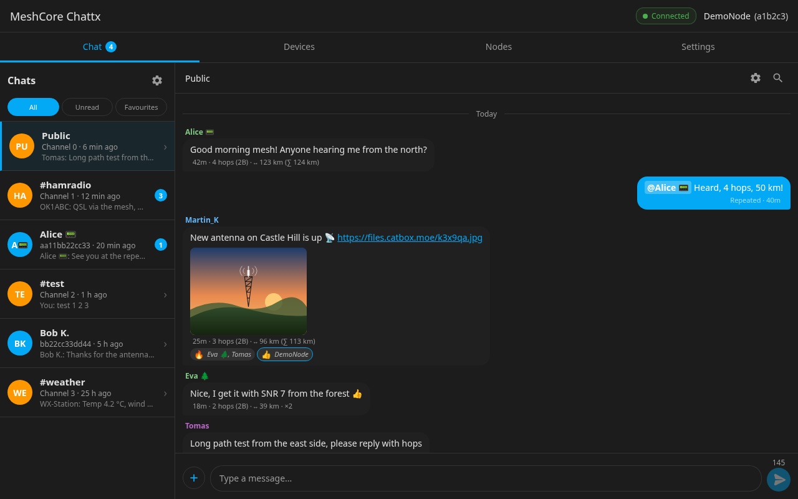</picture></a></p>

<p align="center"><i>Demo data, with made-up names and values. The screenshots follow your GitHub theme: light or dark.</i></p>

It works as a **companion** to the [core meshcore integration](https://github.com/meshcore-dev/meshcore-ha), so install both. This integration does not drive the radio itself. It uses its own domain, `meshcore_chattx`, so it can be installed next to the original, and message history is not shared between them.

> **Status:** in active development. See the [latest release](https://github.com/michalsiman/meshcore-ha-chattx/releases/latest) and the [changelog](CHANGELOG.md).

## Maps without internet

Chattx draws its maps from data kept in Home Assistant, so they work without internet:

- **The route of a message**: the repeaters it went through, with each leg and the total distance
- **All nodes** with a known position, in the Nodes tab
- **What the map shows**: world borders and capitals, and for the countries you choose their borders, regions, towns and peaks (247 countries, Home Assistant's country and its neighbours suggested)
- **Download once**: Settings → Map, a few hundred kB per country, stored in Home Assistant, not in the browser, so every phone and computer gets it
- **Online or offline**: with internet the maps use OpenStreetMap through Home Assistant; without it they switch to the offline map on their own, or you can choose the offline map always

<table>
<tr>
<td width="62%"><a href="https://raw.githubusercontent.com/michalsiman/meshcore-ha-chattx/main/assets/screenshots/chattx-route-map-offline.png"><picture><source media="(prefers-color-scheme: light)" srcset="https://raw.githubusercontent.com/michalsiman/meshcore-ha-chattx/main/assets/screenshots/chattx-route-map-offline-light.png">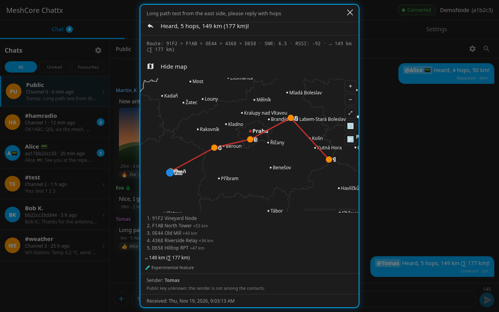</picture></a></td>
<td align="center"><a href="https://raw.githubusercontent.com/michalsiman/meshcore-ha-chattx/main/assets/screenshots/chattx-mobile-route-map-offline.png"><picture><source media="(prefers-color-scheme: light)" srcset="https://raw.githubusercontent.com/michalsiman/meshcore-ha-chattx/main/assets/screenshots/chattx-mobile-route-map-offline-light.png">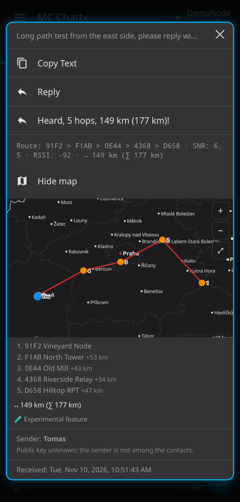</picture></a></td>
</tr>
<tr>
<td><a href="https://raw.githubusercontent.com/michalsiman/meshcore-ha-chattx/main/assets/screenshots/chattx-nodes-map-offline.png"><picture><source media="(prefers-color-scheme: light)" srcset="https://raw.githubusercontent.com/michalsiman/meshcore-ha-chattx/main/assets/screenshots/chattx-nodes-map-offline-light.png">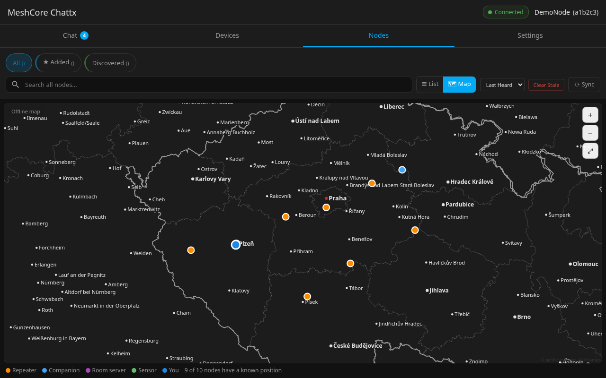</picture></a></td>
<td><a href="https://raw.githubusercontent.com/michalsiman/meshcore-ha-chattx/main/assets/screenshots/chattx-settings-map.png"><picture><source media="(prefers-color-scheme: light)" srcset="https://raw.githubusercontent.com/michalsiman/meshcore-ha-chattx/main/assets/screenshots/chattx-settings-map-light.png">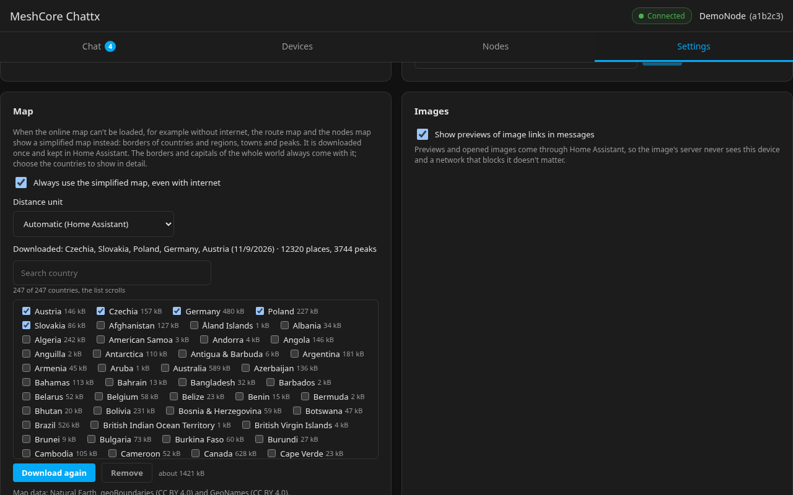</picture></a></td>
</tr>
</table>

## What Chattx adds

Everything below is new or reworked compared with the original MeshCore Chat.

These features were built by [Michal Šiman](https://github.com/michalsiman) ([OK1SIM](https://ok1sim.cz/)) together with [Claude Code](https://claude.com/claude-code), Anthropic's AI coding assistant. Michal ([OK1SIM](https://ok1sim.cz/)) chose the features and tested them on his own MeshCore network, and Claude wrote most of the code.

**Repeaters**, from the lock icon in a repeater's conversation:

- Log in as admin or guest, optionally remembering the password in Home Assistant
- Read settings group by group: name, firmware, radio, location, features, network health and more
- Read telemetry: battery voltage, temperature and any other sensors the repeater reports
- Read neighbours with SNR and when they were last heard
- Read and edit regions: add and remove them, set flood permission, home and default scope
- Terminal: send any command, such as `set tx 22`, and read the reply
- Values stay available after reading, with their age: orange after an hour, red after a day
- Replies to settings reads stay out of the chat and out of the unread counts

**Writing messages**

- A small composer: +, the message field and Send with the bytes left above it; + opens a strip with quick messages, without diacritics, image, location and emoji
- Name suggestions after "@": the radio's contacts and everyone who wrote in the open conversation; Enter or Tab inserts "@[Name] "
- Send a location with 📍: the radio's position, Home Assistant's home or a place picked on the map; received locations open on the map
- Bytes-left counter that counts in UTF-8 bytes, as the radio does
- A message too long for one is sent in numbered parts ("… 1/3", "… 2/3", "… 3/3") of about the same length, at most 8 parts, a few seconds apart; the counter shows how many, for example "3×"
- Emoji reactions on messages (👍 ❤️ 😂 😮 😢 🙏 in the message dialog), in the MeshCore One format, so they work with MeshCore One, MeshCore Open and KiekR
- Long web addresses can be shortened with is.gd before sending; addresses in messages are clickable
- Switch that sends text without diacritics, which leaves more room in a message
- Emoji picker, inserting at the cursor
- Quick messages, managed in Settings
- One-tap quick reply with the sender's name and the message's hop count, such as "Heard, 3 hops!" (the text can be changed in Settings)
- The cursor moves to the message field when you pick a conversation

**Conversation list**

- Sorted by the newest message, with its age in minutes, hours or days
- Readable initials in the circles: `Forest Hill Relay` is FH, `#hiking` is HI, `Anna K. 📟` is A📟
- Switch in the gear menu that hides contact IDs and channel numbers
- The newest message of each conversation (sender and start of the text), switchable in the gear menu
- Unsent drafts stay in the message field per conversation for an hour, also after leaving the panel
- Unread total on the Chat tab; busy channels such as #test can be left out of it in the channel settings, while their own badges still count

**Unread messages outside the panel**

- Sensor `sensor.meshcore_chattx_unread` with the same total as the Chat tab, for a sidebar badge, a dashboard or an automation
- The browser tab title starts with the unread count, such as `(3) Home Assistant`, on every Home Assistant page (can be switched off per browser in Settings)

**Messages**

- Hop count and path size on received messages, for example `3 hops (2B)`
- Experimental: the route of a message on a map, with the repeaters it went through; the map can be sent in a message or copied as a picture
- Experimental: all nodes with a known position on a map in the Nodes tab, with clusters, zoom and node details
- A simplified offline map for both maps when there is no internet: world borders and capitals, and borders, regions, towns and peaks of the countries chosen in Settings → Map (247 countries)
- Optional: repeaters from the public [MeshCore map](https://map.meshcore.io) (by recrof) place the hops of a message's path that your radio has never heard, marked 🌐 (Settings → Map); optionally also networks on other frequencies joined by bridges (same bandwidth, SF and CR), such as the Slovak network bridged to the Czech one
- The distance between the first and last repeater of a received message, and the length of its route
- Images: paste or pick an image, Home Assistant uploads it to catbox.moe and puts the link into the message; image links show a preview

**Nodes**

- Add a contact by hand in the Nodes tab: a public key, a MeshCore QR link, a contact card, or a QR code read from an image
- Node details and the repeater window in Chat show the stored path with repeater names, and can reset it to flood

**Phones**

- The top bar and Back button stay reachable when the keyboard opens
- The keyboard stays open when you press a button next to the message field or send a message
- Shorter title, `MC Chattx`, so the header stays on one line

**Languages**

- English, Czech, Slovak, Polish, German, French, Ukrainian, Croatian, Serbian (Latin), Slovenian, Finnish, Swedish and Danish
- Follows your Home Assistant profile, then your browser, or pick a language in Settings
- Terms from the MeshCore documentation, such as repeater, flood and hop, stay in English
- **Found a mistake?** Translations are plain text files you can fix right on GitHub. See [TRANSLATING.md](TRANSLATING.md)

### Screenshots of the new features

These use demo data, and the names and values are made up.

<table>
<tr>
<td width="50%"><a href="https://raw.githubusercontent.com/michalsiman/meshcore-ha-chattx/main/assets/screenshots/chattx-favorites.png"><picture><source media="(prefers-color-scheme: light)" srcset="https://raw.githubusercontent.com/michalsiman/meshcore-ha-chattx/main/assets/screenshots/chattx-favorites-light.png">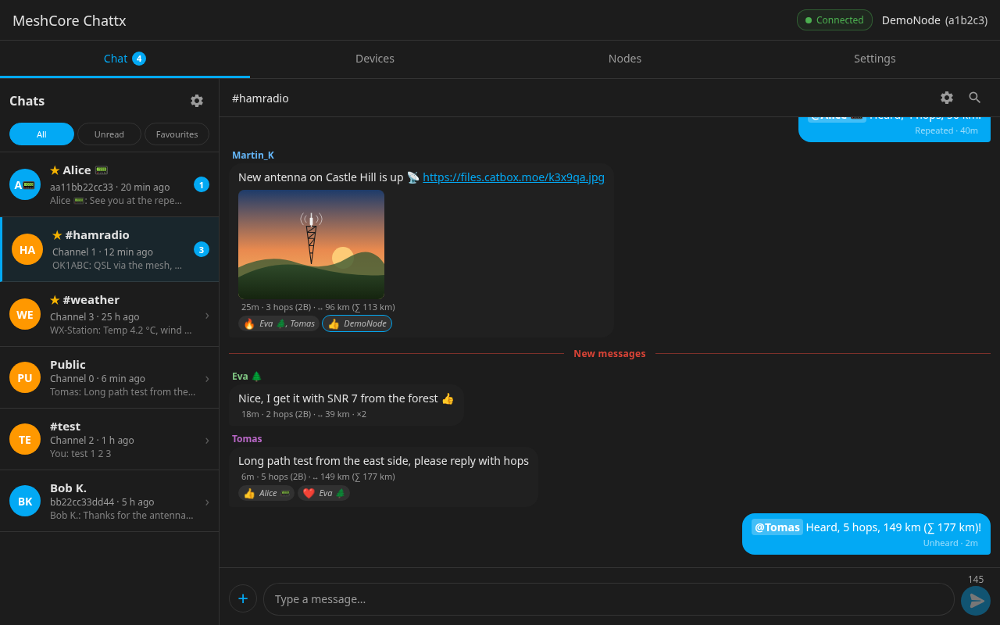</picture></a></td>
<td width="50%"><a href="https://raw.githubusercontent.com/michalsiman/meshcore-ha-chattx/main/assets/screenshots/chattx-manage-favorites.png"><picture><source media="(prefers-color-scheme: light)" srcset="https://raw.githubusercontent.com/michalsiman/meshcore-ha-chattx/main/assets/screenshots/chattx-manage-favorites-light.png">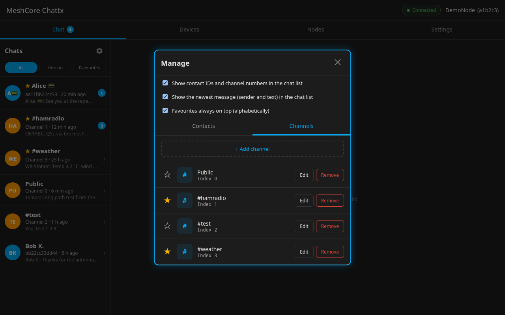</picture></a></td>
</tr>
<tr>
<td><b>Favourites</b> — the chat list filters are All, Unread and Favourites; a gold ★ marks a favourite, and with "Favourites always on top" they come first, alphabetically.</td>
<td><b>Starring chats</b> — in Manage (⚙) a star next to every contact and channel adds it to the favourites; the same favourites on every device.</td>
</tr>
<tr>
<td width="50%"><a href="https://raw.githubusercontent.com/michalsiman/meshcore-ha-chattx/main/assets/screenshots/chattx-heard-repeaters.png"><picture><source media="(prefers-color-scheme: light)" srcset="https://raw.githubusercontent.com/michalsiman/meshcore-ha-chattx/main/assets/screenshots/chattx-heard-repeaters-light.png">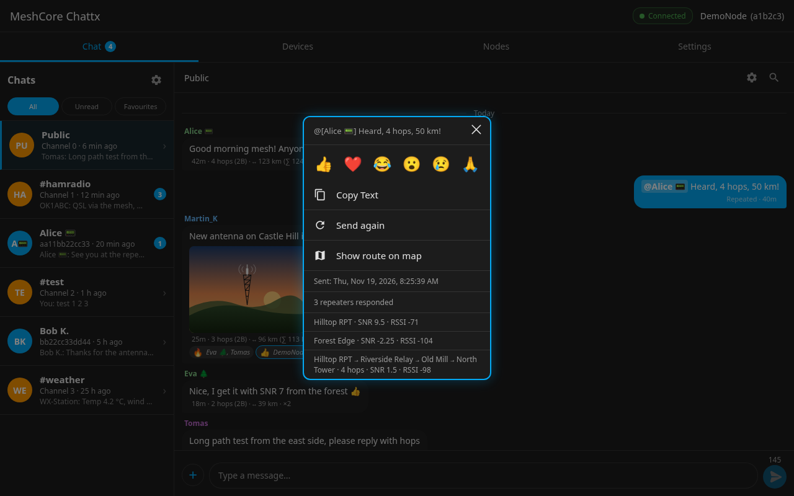</picture></a></td>
<td width="50%"></td>
</tr>
<tr>
<td><b>Who repeated it</b> — the dialog of your own channel message names the repeaters heard repeating it, one line per heard copy with the route, hops and signal.</td>
<td></td>
</tr>
<tr>
<td width="50%"><a href="https://raw.githubusercontent.com/michalsiman/meshcore-ha-chattx/main/assets/screenshots/chattx-chat.png"><picture><source media="(prefers-color-scheme: light)" srcset="https://raw.githubusercontent.com/michalsiman/meshcore-ha-chattx/main/assets/screenshots/chattx-chat-light.png"></picture></a></td>
<td width="50%"><a href="https://raw.githubusercontent.com/michalsiman/meshcore-ha-chattx/main/assets/screenshots/chattx-long-message.png"><picture><source media="(prefers-color-scheme: light)" srcset="https://raw.githubusercontent.com/michalsiman/meshcore-ha-chattx/main/assets/screenshots/chattx-long-message-light.png">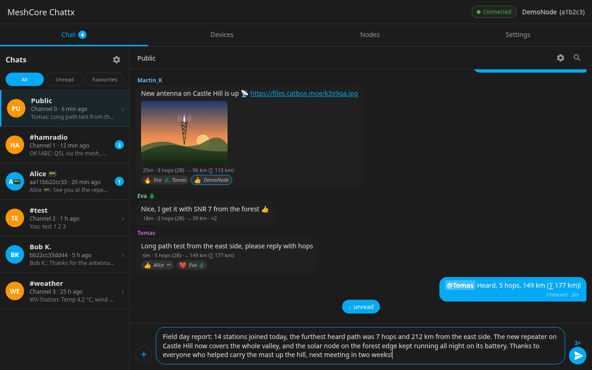</picture></a></td>
</tr>
<tr>
<td><b>Chat</b> — the newest message under each conversation, image previews, reactions, hop count, path size and the distance between the first and last repeater (with the route length in brackets) on messages, ×2 on a message its sender sent twice, and "Unheard" on an own message nobody repeated.</td>
<td><b>Long messages</b> — a text too long for one message goes out in numbered parts; the counter shows "3×", and the parts follow each other a few seconds apart.</td>
</tr>
<tr>
<td><a href="https://raw.githubusercontent.com/michalsiman/meshcore-ha-chattx/main/assets/screenshots/chattx-reactions.png"><picture><source media="(prefers-color-scheme: light)" srcset="https://raw.githubusercontent.com/michalsiman/meshcore-ha-chattx/main/assets/screenshots/chattx-reactions-light.png">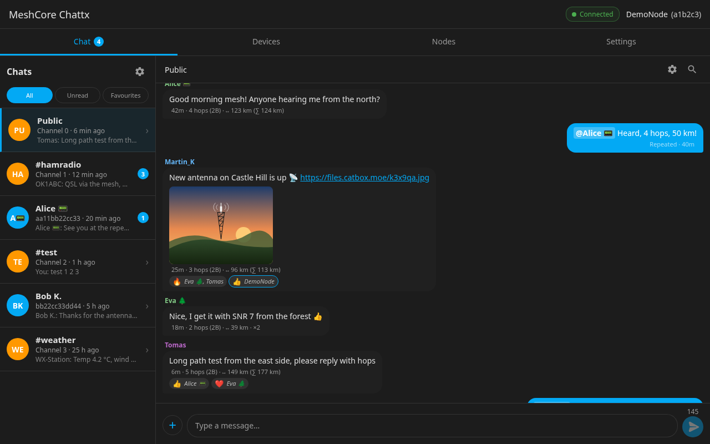</picture></a></td>
<td><a href="https://raw.githubusercontent.com/michalsiman/meshcore-ha-chattx/main/assets/screenshots/chattx-mentions.png"><picture><source media="(prefers-color-scheme: light)" srcset="https://raw.githubusercontent.com/michalsiman/meshcore-ha-chattx/main/assets/screenshots/chattx-mentions-light.png">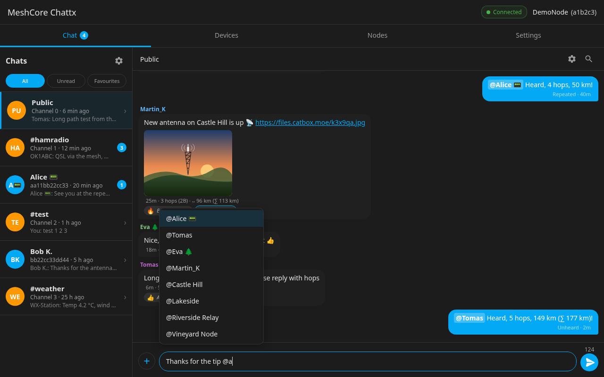</picture></a></td>
</tr>
<tr>
<td><b>Reactions</b> — pick an emoji in the message dialog; reactions show under the message with the names of who sent them (in small italics), and the dialog lists them all. Compatible with MeshCore One, MeshCore Open and KiekR.</td>
<td><b>"@" suggestions</b> — typing "@a" offers contacts and the people of the conversation; Enter, Tab or a tap inserts "@[Name] ".</td>
</tr>
<tr>
<td><a href="https://raw.githubusercontent.com/michalsiman/meshcore-ha-chattx/main/assets/screenshots/chattx-composer-closed.png"><picture><source media="(prefers-color-scheme: light)" srcset="https://raw.githubusercontent.com/michalsiman/meshcore-ha-chattx/main/assets/screenshots/chattx-composer-closed-light.png">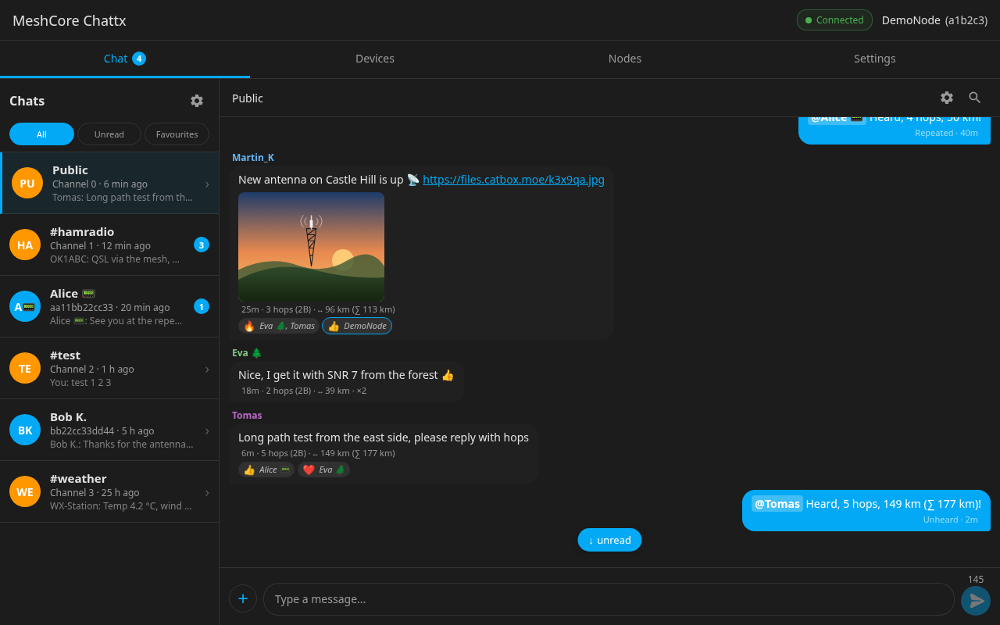</picture></a></td>
<td><a href="https://raw.githubusercontent.com/michalsiman/meshcore-ha-chattx/main/assets/screenshots/chattx-composer.png"><picture><source media="(prefers-color-scheme: light)" srcset="https://raw.githubusercontent.com/michalsiman/meshcore-ha-chattx/main/assets/screenshots/chattx-composer-light.png">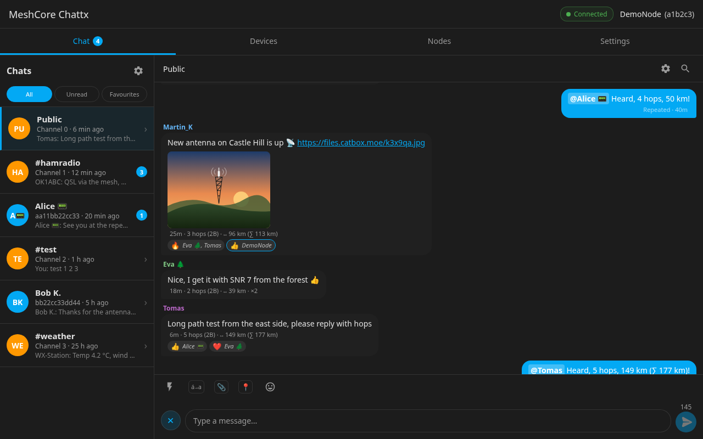</picture></a></td>
</tr>
<tr>
<td><b>Composer</b> — one row: +, the message field (one line while empty, growing as you type) and Send with the bytes left above it.</td>
<td><b>Behind +</b> — quick messages ⚡, without diacritics á→a, image 📎, location 📍 and emoji; a dot on + shows that "without diacritics" is on.</td>
</tr>
<tr>
<td align="center"><a href="https://raw.githubusercontent.com/michalsiman/meshcore-ha-chattx/main/assets/screenshots/chattx-mobile-composer.png"><picture><source media="(prefers-color-scheme: light)" srcset="https://raw.githubusercontent.com/michalsiman/meshcore-ha-chattx/main/assets/screenshots/chattx-mobile-composer-light.png"></picture></a></td>
<td align="center"><a href="https://raw.githubusercontent.com/michalsiman/meshcore-ha-chattx/main/assets/screenshots/chattx-mobile-composer-tools.png"><picture><source media="(prefers-color-scheme: light)" srcset="https://raw.githubusercontent.com/michalsiman/meshcore-ha-chattx/main/assets/screenshots/chattx-mobile-composer-tools-light.png"></picture></a></td>
</tr>
<tr>
<td align="center"><b>Phone</b> — more of the conversation fits on the screen.</td>
<td align="center"><b>Phone, + open</b> — the tools in one strip above the field.</td>
</tr>
<tr>
<td><a href="https://raw.githubusercontent.com/michalsiman/meshcore-ha-chattx/main/assets/screenshots/chattx-image-upload.png"><picture><source media="(prefers-color-scheme: light)" srcset="https://raw.githubusercontent.com/michalsiman/meshcore-ha-chattx/main/assets/screenshots/chattx-image-upload-light.png">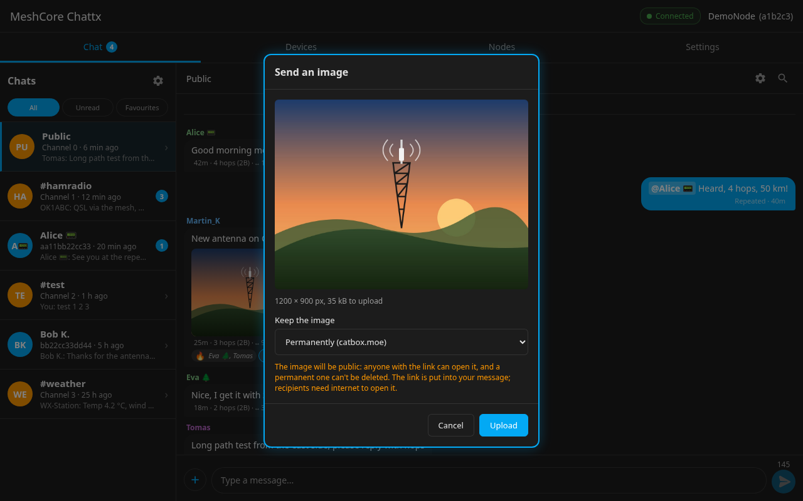</picture></a></td>
<td><a href="https://raw.githubusercontent.com/michalsiman/meshcore-ha-chattx/main/assets/screenshots/chattx-image-viewer.png"><picture><source media="(prefers-color-scheme: light)" srcset="https://raw.githubusercontent.com/michalsiman/meshcore-ha-chattx/main/assets/screenshots/chattx-image-viewer-light.png">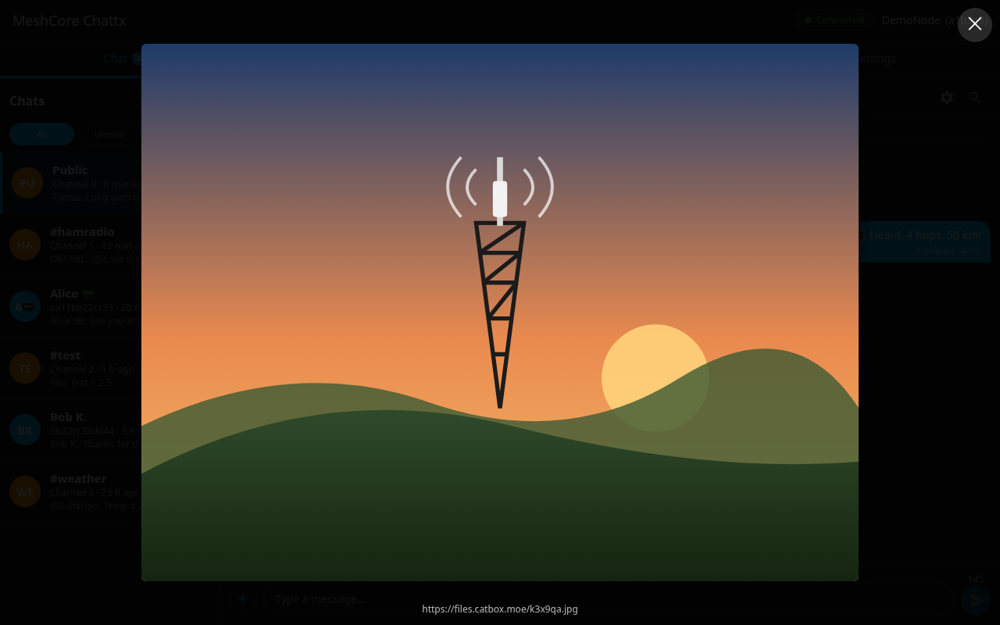</picture></a></td>
</tr>
<tr>
<td><b>Images</b> — paste an image or pick one with 📎; Home Assistant uploads it to catbox.moe, litterbox or tmpfiles.org and the link goes into the message.</td>
<td><b>Image viewer</b> — a tap on a preview shows the image large over the conversation; ✕, a tap beside it, Escape or the back gesture closes it.</td>
</tr>
<tr>
<td><a href="https://raw.githubusercontent.com/michalsiman/meshcore-ha-chattx/main/assets/screenshots/chattx-route-map-offline.png"><picture><source media="(prefers-color-scheme: light)" srcset="https://raw.githubusercontent.com/michalsiman/meshcore-ha-chattx/main/assets/screenshots/chattx-route-map-offline-light.png"></picture></a></td>
<td align="center"><a href="https://raw.githubusercontent.com/michalsiman/meshcore-ha-chattx/main/assets/screenshots/chattx-mobile-route-map-offline.png"><picture><source media="(prefers-color-scheme: light)" srcset="https://raw.githubusercontent.com/michalsiman/meshcore-ha-chattx/main/assets/screenshots/chattx-mobile-route-map-offline-light.png"></picture></a></td>
</tr>
<tr>
<td><b>Offline map</b> — without internet (or always, if chosen) the maps are drawn from data kept in Home Assistant: borders, regions, towns and peaks.</td>
<td align="center"><b>Phone</b> — the same on a phone; one finger moves the map, two zoom.</td>
</tr>
<tr>
<td><a href="https://raw.githubusercontent.com/michalsiman/meshcore-ha-chattx/main/assets/screenshots/chattx-nodes-map-offline.png"><picture><source media="(prefers-color-scheme: light)" srcset="https://raw.githubusercontent.com/michalsiman/meshcore-ha-chattx/main/assets/screenshots/chattx-nodes-map-offline-light.png"></picture></a></td>
<td><a href="https://raw.githubusercontent.com/michalsiman/meshcore-ha-chattx/main/assets/screenshots/chattx-send-again.png"><picture><source media="(prefers-color-scheme: light)" srcset="https://raw.githubusercontent.com/michalsiman/meshcore-ha-chattx/main/assets/screenshots/chattx-send-again-light.png">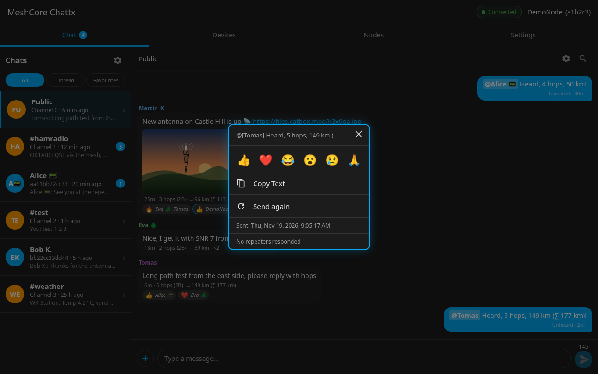</picture></a></td>
</tr>
<tr>
<td><b>Nodes on the offline map</b> — the Nodes tab map works offline too.</td>
<td><b>Send again</b> — the same text once more, for example when nobody heard it.</td>
</tr>
<tr>
<td><a href="https://raw.githubusercontent.com/michalsiman/meshcore-ha-chattx/main/assets/screenshots/chattx-settings-blocklist.png"><picture><source media="(prefers-color-scheme: light)" srcset="https://raw.githubusercontent.com/michalsiman/meshcore-ha-chattx/main/assets/screenshots/chattx-settings-blocklist-light.png">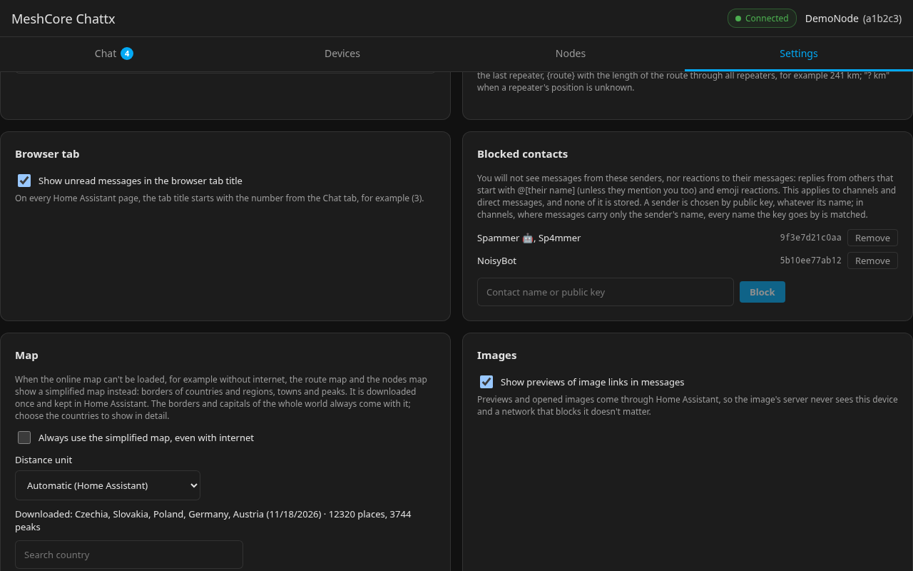</picture></a></td>
<td><a href="https://raw.githubusercontent.com/michalsiman/meshcore-ha-chattx/main/assets/screenshots/chattx-settings-map.png"><picture><source media="(prefers-color-scheme: light)" srcset="https://raw.githubusercontent.com/michalsiman/meshcore-ha-chattx/main/assets/screenshots/chattx-settings-map-light.png"></picture></a></td>
</tr>
<tr>
<td><b>Blocked contacts</b> — chosen by public key; neither their messages nor replies and reactions to them are shown or stored.</td>
<td><b>Map settings</b> — countries for the offline map (247, Home Assistant's country and its neighbours suggested), distance unit, and the switch for the offline map only.</td>
</tr>
<tr>
<td><a href="https://raw.githubusercontent.com/michalsiman/meshcore-ha-chattx/main/assets/screenshots/chattx-route-map.png"><picture><source media="(prefers-color-scheme: light)" srcset="https://raw.githubusercontent.com/michalsiman/meshcore-ha-chattx/main/assets/screenshots/chattx-route-map-light.png">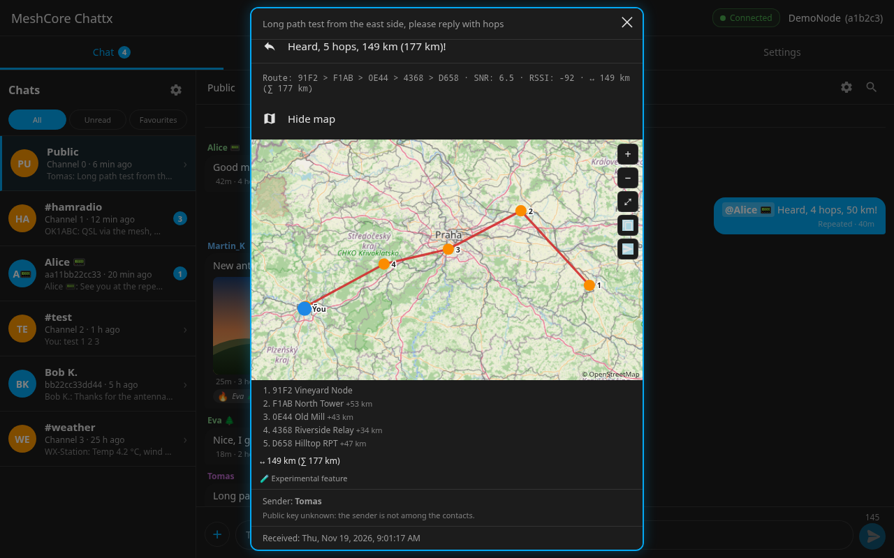</picture></a></td>
<td align="center"><a href="https://raw.githubusercontent.com/michalsiman/meshcore-ha-chattx/main/assets/screenshots/chattx-mobile-route-map.png"><picture><source media="(prefers-color-scheme: light)" srcset="https://raw.githubusercontent.com/michalsiman/meshcore-ha-chattx/main/assets/screenshots/chattx-mobile-route-map-light.png">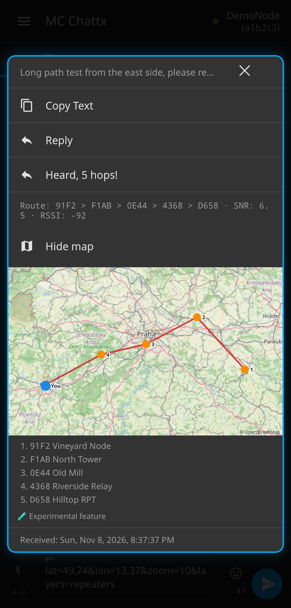</picture></a></td>
</tr>
<tr>
<td><b>Route on a map</b> (experimental) — the repeaters a message went through, found among your contacts by their key prefix and drawn over OpenStreetMap (loaded through Home Assistant); the map can be dragged and zoomed, and the list below gives each leg and both distances.</td>
<td align="center"><b>Phone</b> — the same map; the dialog scrolls, and the back gesture hides the map, then closes the dialog.</td>
</tr>
<tr>
<td><a href="https://raw.githubusercontent.com/michalsiman/meshcore-ha-chattx/main/assets/screenshots/chattx-message-popup.png"><picture><source media="(prefers-color-scheme: light)" srcset="https://raw.githubusercontent.com/michalsiman/meshcore-ha-chattx/main/assets/screenshots/chattx-message-popup-light.png">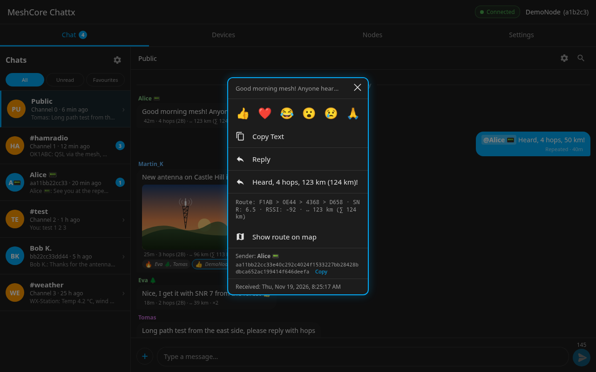</picture></a></td>
<td><a href="https://raw.githubusercontent.com/michalsiman/meshcore-ha-chattx/main/assets/screenshots/chattx-hide-ids.png"><picture><source media="(prefers-color-scheme: light)" srcset="https://raw.githubusercontent.com/michalsiman/meshcore-ha-chattx/main/assets/screenshots/chattx-hide-ids-light.png">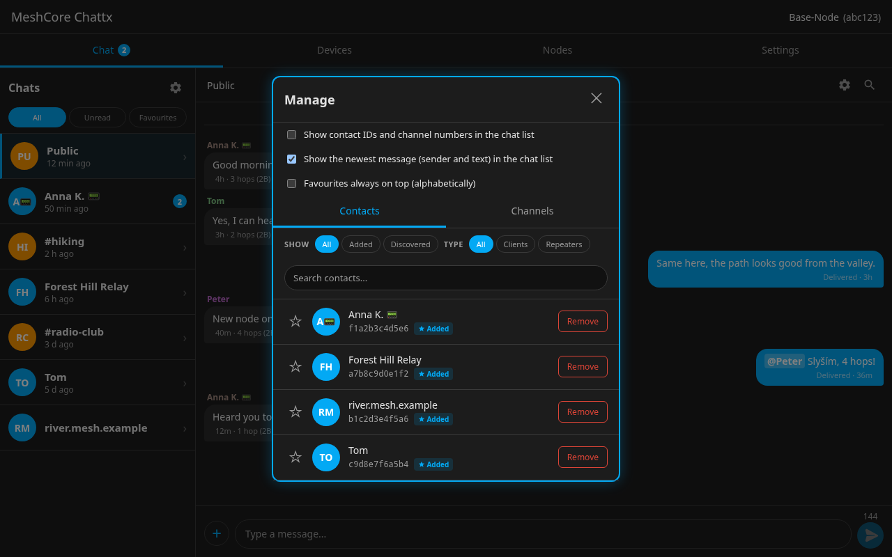</picture></a></td>
</tr>
<tr>
<td><b>Message details</b> — the route with its distances, the sender's public key to copy, and a quick reply set in Settings with {hops}, {km} and {route}, here "Heard, 4 hops, 123 km (124 km)!".</td>
<td><b>Cleaner list</b> — the gear menu hides contact IDs and channel numbers.</td>
</tr>
<tr>
<td><a href="https://raw.githubusercontent.com/michalsiman/meshcore-ha-chattx/main/assets/screenshots/chattx-repeater-login-telemetry.png"><picture><source media="(prefers-color-scheme: light)" srcset="https://raw.githubusercontent.com/michalsiman/meshcore-ha-chattx/main/assets/screenshots/chattx-repeater-login-telemetry-light.png">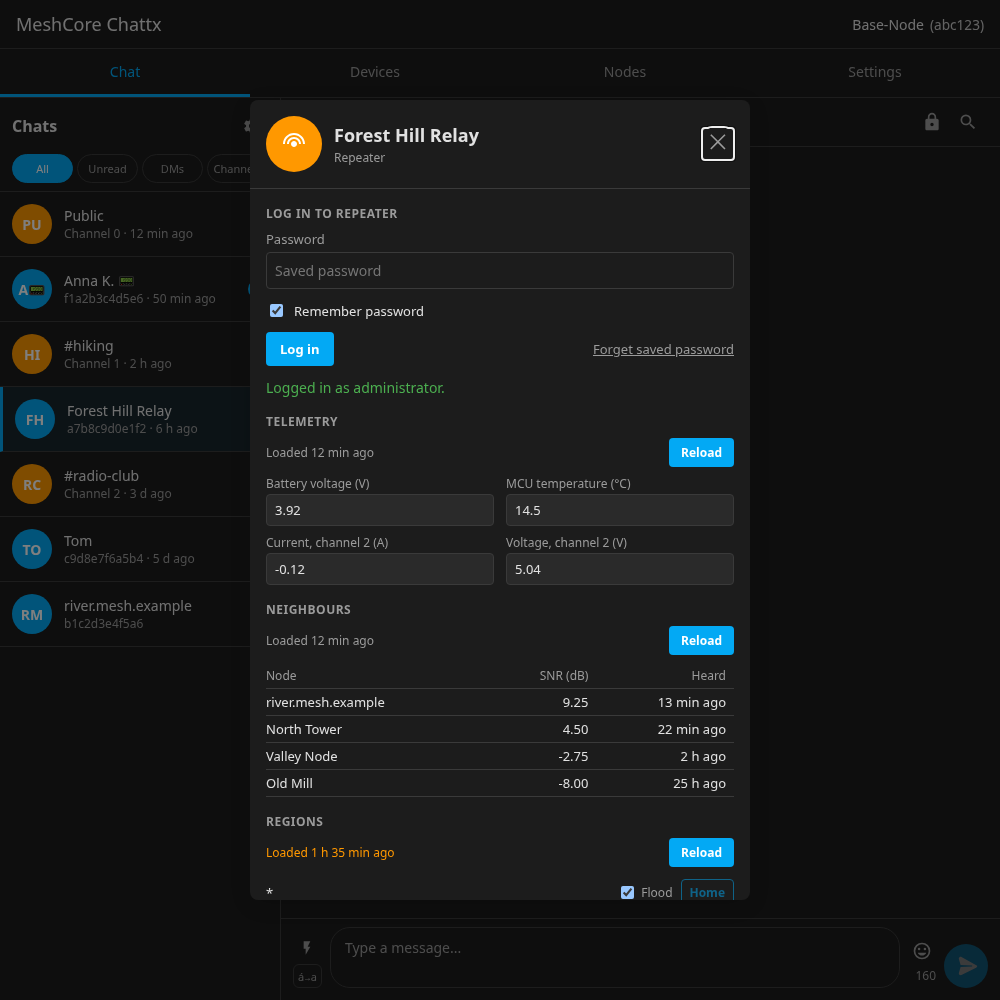</picture></a></td>
<td><a href="https://raw.githubusercontent.com/michalsiman/meshcore-ha-chattx/main/assets/screenshots/chattx-repeater-settings.png"><picture><source media="(prefers-color-scheme: light)" srcset="https://raw.githubusercontent.com/michalsiman/meshcore-ha-chattx/main/assets/screenshots/chattx-repeater-settings-light.png">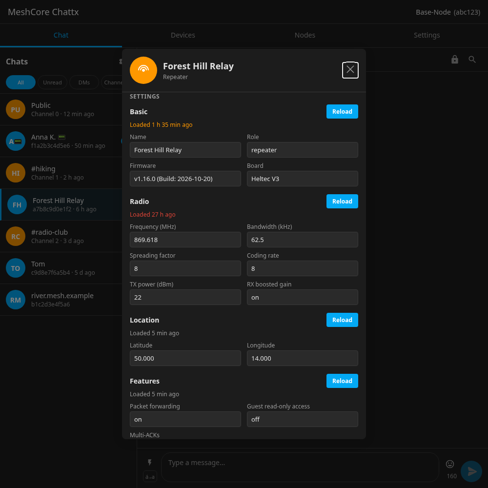</picture></a></td>
</tr>
<tr>
<td><b>Repeater login, telemetry and neighbours</b> — the header stays in place while the content scrolls.</td>
<td><b>Repeater settings</b> — read group by group, with the age of each group.</td>
</tr>
<tr>
<td><a href="https://raw.githubusercontent.com/michalsiman/meshcore-ha-chattx/main/assets/screenshots/chattx-repeater-regions.png"><picture><source media="(prefers-color-scheme: light)" srcset="https://raw.githubusercontent.com/michalsiman/meshcore-ha-chattx/main/assets/screenshots/chattx-repeater-regions-light.png">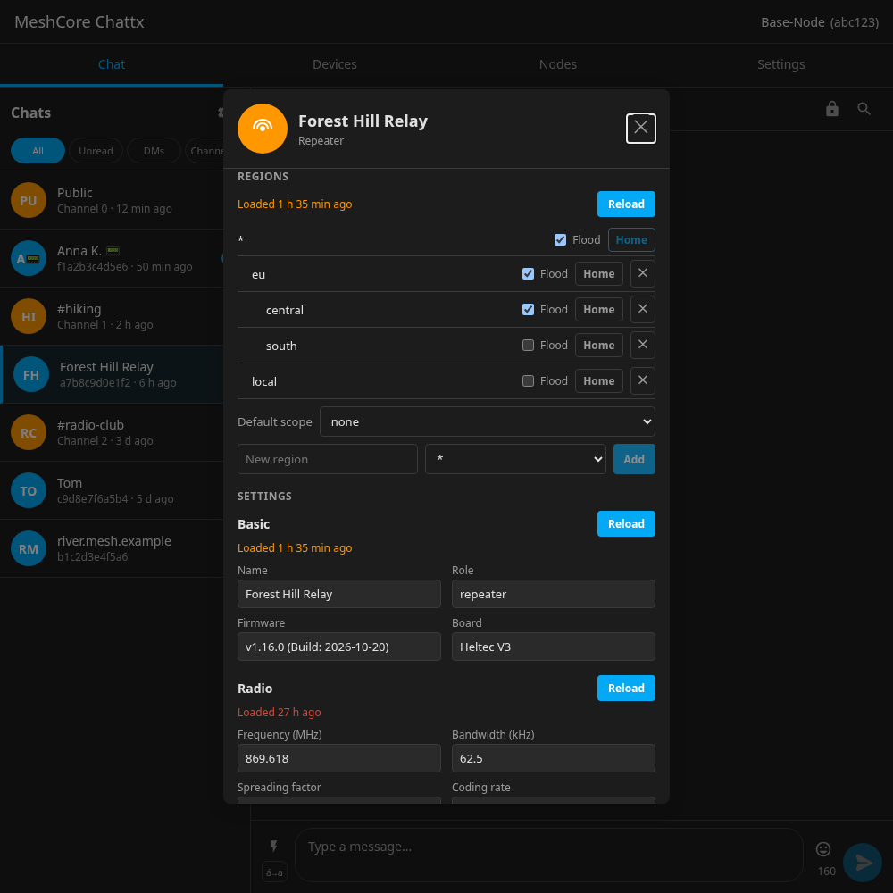</picture></a></td>
<td><a href="https://raw.githubusercontent.com/michalsiman/meshcore-ha-chattx/main/assets/screenshots/chattx-repeater-terminal.png"><picture><source media="(prefers-color-scheme: light)" srcset="https://raw.githubusercontent.com/michalsiman/meshcore-ha-chattx/main/assets/screenshots/chattx-repeater-terminal-light.png">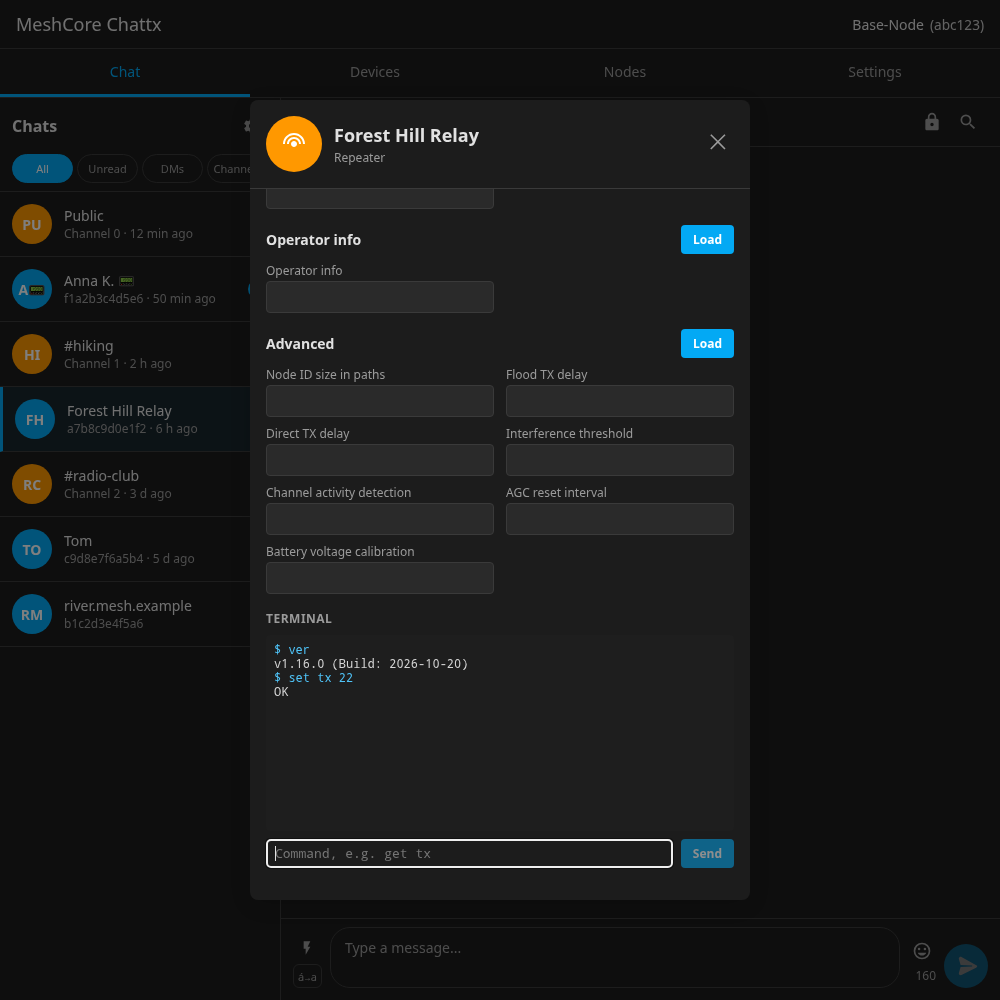</picture></a></td>
</tr>
<tr>
<td><b>Regions</b> — edit the region tree and save it to the repeater.</td>
<td><b>Terminal</b> — send any command to the repeater.</td>
</tr>
</table>

<table>
<tr>
<td width="50%" align="center"><a href="https://raw.githubusercontent.com/michalsiman/meshcore-ha-chattx/main/assets/screenshots/chattx-mobile-list.png"><picture><source media="(prefers-color-scheme: light)" srcset="https://raw.githubusercontent.com/michalsiman/meshcore-ha-chattx/main/assets/screenshots/chattx-mobile-list-light.png">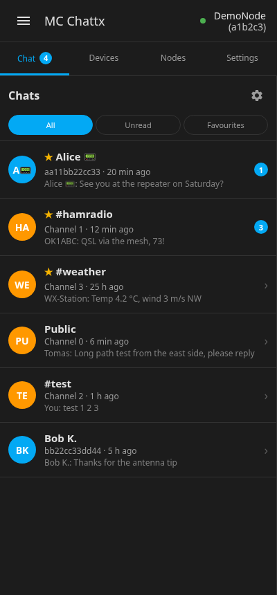</picture></a></td>
<td width="50%" align="center"><a href="https://raw.githubusercontent.com/michalsiman/meshcore-ha-chattx/main/assets/screenshots/chattx-mobile-chat.png"><picture><source media="(prefers-color-scheme: light)" srcset="https://raw.githubusercontent.com/michalsiman/meshcore-ha-chattx/main/assets/screenshots/chattx-mobile-chat-light.png">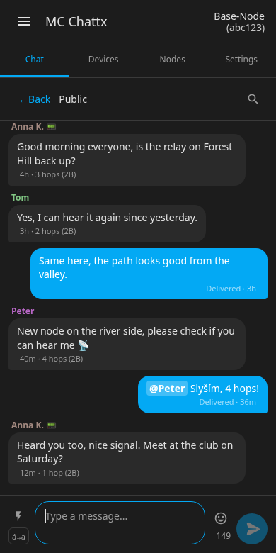</picture></a></td>
</tr>
<tr>
<td align="center"><b>Phone</b> — conversation list with the newest message of each conversation.</td>
<td align="center"><b>Phone</b> — chat with the compact message bar.</td>
</tr>
</table>

## Features from the original

- Sidebar chat panel with channels, DMs, and contact list
- Persistent message history (survives Home Assistant restarts)
- Trace / path-discovery dialog with route visualization
- Per-conversation search
- Unread counts, delivery status
- Live device telemetry, neighbor tables, and remote command issue from the same UI
- Network-wide node discovery view (typically hundreds of nodes)

## More screenshots

The Chat images use demo data. The others come from the original MeshCore Chat, so some details differ from the current version, such as the title.

### The four main tabs

<table>
<tr>
<td width="50%"><a href="https://raw.githubusercontent.com/michalsiman/meshcore-ha-chattx/main/assets/screenshots/chattx-chat.png"><picture><source media="(prefers-color-scheme: light)" srcset="https://raw.githubusercontent.com/michalsiman/meshcore-ha-chattx/main/assets/screenshots/chattx-chat-light.png"></picture></a></td>
<td width="50%"><a href="https://raw.githubusercontent.com/michalsiman/meshcore-ha-chattx/main/assets/screenshots/devices-tab.jpg"></a></td>
</tr>
<tr>
<td><b>Chat</b> — channels and DMs in the left rail with All / Unread / Favourites filters (star chats in Manage); messages rendered with sender, age, hop count, path size and delivery status (Repeated / Sent / Waiting).</td>
<td><b>Devices</b> — per-device sensor tiles (SNR, RSSI, airtime, battery, message counts) with a neighbor table and quick-action buttons (Flood Advert, Sync Clock, Req Telemetry, Req Status).</td>
</tr>
<tr>
<td><a href="https://raw.githubusercontent.com/michalsiman/meshcore-ha-chattx/main/assets/screenshots/nodes-tab.jpg"></a></td>
<td><a href="https://raw.githubusercontent.com/michalsiman/meshcore-ha-chattx/main/assets/screenshots/settings-tab.jpg"></a></td>
</tr>
<tr>
<td><b>Nodes</b> — full network discovery view (All / Added / Discovered, then Clients / Repeaters), with search, last-heard sort, and stale-record cleanup.</td>
<td><b>Settings</b> — companion device profile, radio configuration (TX power, frequency, bandwidth, spreading factor, coding rate, path hash mode), rename, and location. When <b>Self Diagnostics</b> is enabled in the upstream meshcore integration, the companion card also shows the same rich tiles managed devices have (battery, signal, radio activity, message counts) plus a diagnostics sensor table.</td>
</tr>
</table>

### Chat features

<table>
<tr>
<td width="50%"><a href="https://raw.githubusercontent.com/michalsiman/meshcore-ha-chattx/main/assets/screenshots/chattx-message-popup.png"><picture><source media="(prefers-color-scheme: light)" srcset="https://raw.githubusercontent.com/michalsiman/meshcore-ha-chattx/main/assets/screenshots/chattx-message-popup-light.png"></picture></a></td>
<td width="50%"><a href="https://raw.githubusercontent.com/michalsiman/meshcore-ha-chattx/main/assets/screenshots/chattx-hide-ids.png"><picture><source media="(prefers-color-scheme: light)" srcset="https://raw.githubusercontent.com/michalsiman/meshcore-ha-chattx/main/assets/screenshots/chattx-hide-ids-light.png"></picture></a></td>
</tr>
<tr>
<td><b>Message popup</b> — click or tap any message for Copy, Reply or the one-tap quick reply, plus the route metadata: hop sequence, SNR, RSSI, and exact receive timestamp.</td>
<td><b>Manage contacts &amp; channels</b> — promote any discovered node to an Added contact, or remove it; channel list lives on the second tab. The switch at the top hides contact IDs and channel numbers in the chat list.</td>
</tr>
</table>

### Nodes features

<table>
<tr>
<td width="50%"><a href="https://raw.githubusercontent.com/michalsiman/meshcore-ha-chattx/main/assets/screenshots/node-popup.jpg"></a></td>
<td width="50%"><a href="https://raw.githubusercontent.com/michalsiman/meshcore-ha-chattx/main/assets/screenshots/trace-dialog.jpg"></a></td>
</tr>
<tr>
<td><b>Node details</b> — click any node tile in the Nodes tab to open quick actions (Trace, Remove Contact), public-key prefix, type, last advert, and location.</td>
<td><b>Path trace</b> — launched from the Trace quick action in the Node details dialog; pick repeaters in order to test a multi-hop path, or run a direct-neighbor probe; resolved path is shown alongside.</td>
</tr>
</table>

### Device management

<table>
<tr>
<td width="50%"><a href="https://raw.githubusercontent.com/michalsiman/meshcore-ha-chattx/main/assets/screenshots/device-settings.jpg"></a></td>
<td width="50%"><a href="https://raw.githubusercontent.com/michalsiman/meshcore-ha-chattx/main/assets/screenshots/device-command.jpg"></a></td>
</tr>
<tr>
<td><b>Device settings menu</b> — per-device gear menu: View Hidden Sensors, Issue Command, Reboot, Start OTA Update.</td>
<td><b>Issue Command</b> — full command catalog grouped by category (Device Management, Device Info, etc.) — drives the underlying meshcore service from the panel.</td>
</tr>
<tr>
<td><a href="https://raw.githubusercontent.com/michalsiman/meshcore-ha-chattx/main/assets/screenshots/companion-settings.jpg"></a></td>
<td><a href="https://raw.githubusercontent.com/michalsiman/meshcore-ha-chattx/main/assets/screenshots/tile-more-info.jpg"></a></td>
</tr>
<tr>
<td><b>Companion settings menu</b> — same gear menu pattern for the local companion device, with Key Management as an additional option.</td>
<td><b>Sensor history</b> — clicking any sensor tile opens Home Assistant's standard more-info dialog with full historical chart.</td>
</tr>
</table>

## Installation

### Marketplace or HACS (custom repository)

From Home Assistant 2026.11, HACS is built in as the Marketplace under Settings. Older versions use HACS.

[](https://my.home-assistant.io/redirect/hacs_repository/?owner=michalsiman&repository=meshcore-ha-chattx&category=integration)

> [!TIP]
> If the badge opens a wrong address (such as `homeassistant.local:8123` when your Home Assistant runs elsewhere), set your Home Assistant's address once at [my.home-assistant.io](https://my.home-assistant.io/) and click it again.

Click the badge above to open this repository, or follow the manual steps:

1. Open the Marketplace or HACS and go to its custom repositories
2. Add `https://github.com/michalsiman/meshcore-ha-chattx` as an "Integration"
3. Install **MeshCore Chattx**
4. Restart Home Assistant
5. Settings → Devices & Services → Add Integration → **MeshCore Chattx**

### Manual

Copy `custom_components/meshcore_chattx/` into your HA `config/custom_components/` directory. Restart HA. Add the integration from the UI.

## Usage

For a walkthrough of common tasks (adding contacts, managing channels, issuing commands, tracing paths, changing radio settings) plus operational warnings (radio-reboot requirements, the entity_id rename gotcha), see [INSTRUCTIONS.md](./INSTRUCTIONS.md).

> **Permissions.** Reading messages and browsing the panel works for any authenticated HA user. **Destructive actions** — radio reconfiguration, identity regeneration, channel-key changes, issuing commands, adding / removing / blocking contacts, and running path traces — require **administrator** rights on your HA instance. See [INSTRUCTIONS.md → Permissions](./INSTRUCTIONS.md#permissions) for the full list.

## Requirements

- Home Assistant 2024.12 or newer
- The core [meshcore integration](https://github.com/meshcore-dev/meshcore-ha) **v2.7.0 or newer** installed and configured. The per-channel region scope selector and the "All regions" option rely on the message `scope` argument and the inbound `region_scope` / `flood_scope` fields that landed in the core integration's v2.7.0 (released 2026-05-31). The chat companion also calls the structured query services (`meshcore.get_contacts`, `meshcore.trace`) introduced in 2.6.0; on a core older than the floor the trace dialog returns a *"service not registered"* error and the contact list falls back to a legacy code path with a one-time warning in the logs.

## Security

Security issues can be reported privately — see [SECURITY.md](SECURITY.md). For how the integration handles untrusted, mesh-sourced data and where its trust boundaries are, see [docs/security-posture.md](docs/security-posture.md).

[](https://scorecard.dev/viewer/?uri=github.com/michalsiman/meshcore-ha-chattx)
[](https://github.com/michalsiman/meshcore-ha-chattx/actions/workflows/codeql.yml)

## Relationship to other projects

- [meshcore-dev/meshcore-ha](https://github.com/meshcore-dev/meshcore-ha) — the core integration that drives the MeshCore radio. **Required.**  
  [](https://my.home-assistant.io/redirect/hacs_repository/?owner=meshcore-dev&repository=meshcore-ha&category=integration)

## Use cases

- **Off-grid mesh chat panel.** Run a tablet in your kitchen showing the MeshCore Chattx sidebar; talk to local mesh peers without leaving Home Assistant.
- **Search recent traffic.** "Who pinged the @[Repeater Cliff] node yesterday?" — date-range message search across all conversations.
- **Path diagnostics.** Trace the route a message took (hops, SNR, RSSI per repeater) right from the message bubble.
- **Managed-device dashboard.** Monitor battery, last-heard, neighbour SNR, and uptime on every repeater you've added — one card per device.

## Known limitations

- **Requires meshcore ≥ 2.7.0.** The per-channel region scope selector and "All regions" option need core-integration support that landed in v2.7.0; Trace and Get Contacts use upstream services from 2.6.0, and older cores fall back to direct coordinator reads where supported.
- **Message archive is not a long-term log.** Default retention is 90 days, capped at 500 messages per conversation. Configurable via Settings → MeshCore Chattx → Configure (range 1–365 days, 50–5000 messages).
- **Discover-mode traces don't always return.** Flood path discovery on multi-hop routes sometimes silently drops. If a **Discover** trace fails, switch to **Select repeaters** or **Enter path** in the trace dialog to specify the route explicitly.

## Removal

To uninstall:

1. Settings → Devices & Services → MeshCore Chattx → ⋮ → Delete.
2. Optional: remove the message archive from disk:
   ```bash
   rm /config/.storage/meshcore_chattx.*
   ```
   The archive is per-entry; deleting the config entry does not remove these files automatically (HA's standard behaviour). Skip this step if you intend to re-add the integration later — the archive will be re-attached.
3. If you also want to uninstall the underlying meshcore integration: Settings → Devices & Services → MeshCore → Delete, then remove `custom_components/meshcore` (HACS or manual).

## Development

Contributions and bug reports welcome — file issues at [github.com/michalsiman/meshcore-ha-chattx/issues](https://github.com/michalsiman/meshcore-ha-chattx/issues).

### Repo layout

- `custom_components/meshcore_chattx/` — the Home Assistant integration (Python).
- `frontend/` — the Lit-based sidebar panel (TypeScript). Rolled up into a single bundle that lands at `custom_components/meshcore_chattx/meshcore-chattx-panel.js`.
- `tests/` — Python test suite (pytest + `pytest-homeassistant-custom-component`).
- `frontend/tests/` — frontend unit tests (vitest).

QR codes in images are read with [jsQR](https://github.com/cozmo/jsQR) (Apache-2.0), bundled into the panel.

### Python tests

The integration targets the Python version shipped in the current HA OS / Docker image (3.14 as of HA 2025.x). Set up a local venv:

```bash
cd meshcore-ha-chattx
uv venv --python 3.14 .venv
.venv/bin/pip install pytest-homeassistant-custom-component
```

`pytest-homeassistant-custom-component` (PHACC) transitively pulls in Home Assistant core, pytest, pytest-asyncio, and the full HA test fixture surface — no other install steps are needed. The integration is **not** installed as a package; `tests/conftest.py` puts the repo root on `sys.path` so `custom_components.meshcore_chattx.*` is importable directly.

Run the suite:

```bash
.venv/bin/pytest tests/                    # full suite (~1s)
.venv/bin/pytest tests/components/meshcore_chattx/test_ws_api.py -k identity
```

> **Do not** `pip install -e .[test]` (or any pip install) inside a running Home Assistant Docker container. The editable-install metadata persists across `pip uninstall` and crashes HA on the next restart with `FileNotFoundError` from `async_get_custom_components`. Always use a separate venv.

### Frontend

```bash
cd frontend
npm install
npm run build       # production bundle (minified)
npm run dev         # rollup watch mode
npm test            # vitest, run once
npm run test:watch  # vitest in watch mode
npm run lint        # eslint
```

The build writes straight to `../custom_components/meshcore_chattx/meshcore-chattx-panel.js`. Committing the rebuilt bundle does not deploy it — for that, see below.

### Deploying a dev build to a live HA host

After `npm run build`, copy the rebuilt panel bundle to your HA host:

```bash
scp custom_components/meshcore_chattx/meshcore-chattx-panel.js \
    root@<ha-host>:/config/custom_components/meshcore_chattx/
```

Then **hard-refresh** the panel in the browser (Cmd/Ctrl-Shift-R). No Home Assistant restart is needed for frontend-only changes — the panel is reloaded from disk on browser refresh.

For Python-side changes (anything under `custom_components/meshcore_chattx/*.py`), SCP the changed files and reload the integration: **Settings → Devices & Services → MeshCore Chattx → ⋮ → Reload**, or restart HA if the change touches `__init__.py`, the config-flow, or anything wired at setup time.

## Tips & Troubleshooting

The integration should be fairly easy to understand and navigate, for instructions on dialog pop-ups and operational gotchas worth knowing, see [INSTRUCTIONS.md](./INSTRUCTIONS.md).

## License

MIT — see [LICENSE](LICENSE).
