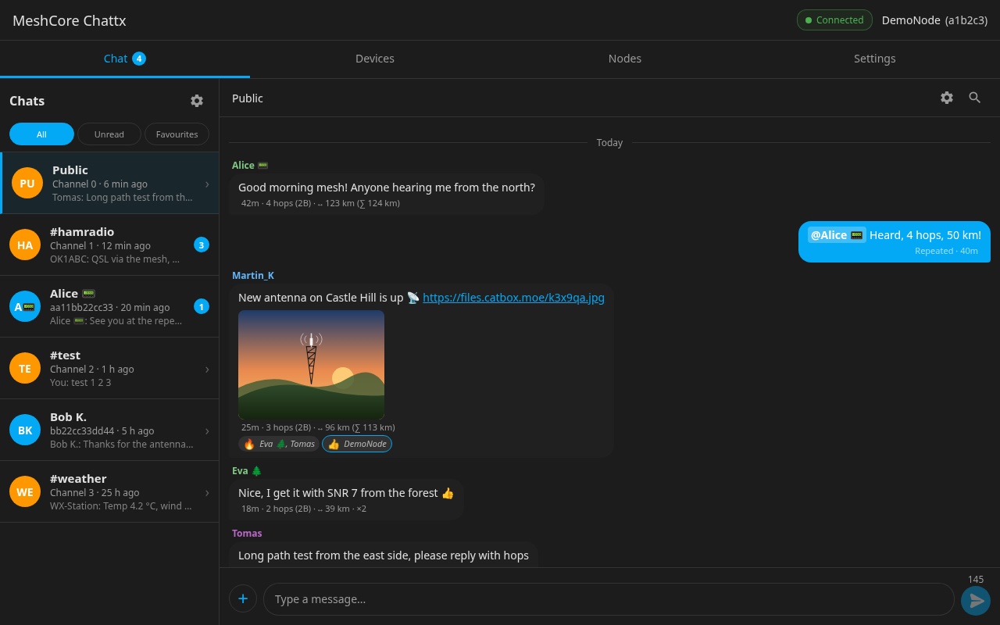

> [!WARNING]
> **Development paused (November 2026).** Many users of the MeshCore network don't like that a Home Assistant panel makes the mesh reachable over the internet, which goes against the basic idea of MeshCore: communication that works without the internet. This happened even though Chattx was designed from the start to work offline, including its maps, and was meant above all for emergency communication. The code stays as it is, but there will be no new releases or fixes for now. Thank you all for your support so far. 73, Michal OK1SIM

# MeshCore Chattx

Sidebar chat panel and persistent message store for the MeshCore mesh radio network.

A **companion** integration: works alongside the [core meshcore integration](https://github.com/meshcore-dev/meshcore-ha) without modifying it. Install both.

**Features:**

- Sidebar chat panel — channels, DMs, contacts
- Repeater login, settings, telemetry, neighbours, regions and a command terminal
- Bytes-left counter, send without diacritics, emoji and quick messages
- Works on phones, with the top bar and keyboard staying in place
- Persistent message history
- Trace / path-discovery dialog
- Per-conversation search
- Unread counts and delivery status

**Requires:** Home Assistant 2024.12+, the core meshcore integration installed and configured.
