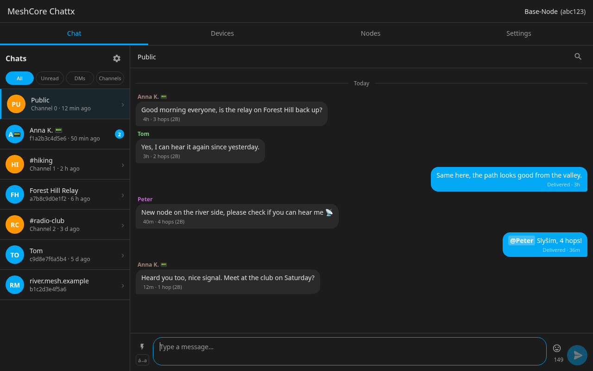

# MeshCore Chattx

Sidebar chat panel and persistent message store for the MeshCore mesh radio network.

A **companion** integration: works alongside the [core meshcore integration](https://github.com/meshcore-dev/meshcore-ha) without modifying it. Install both.

**Features:**

- Sidebar chat panel — channels, DMs, contacts
- Repeater login, settings, telemetry, neighbours, regions and a command terminal
- Bytes-left counter, send without diacritics, emoji and quick messages
- Works on phones, with the top bar and keyboard staying in place
- Persistent message history
- Trace / path-discovery dialog
- Per-conversation search
- Unread counts and delivery status

**Requires:** Home Assistant 2024.12+, the core meshcore integration installed and configured.
